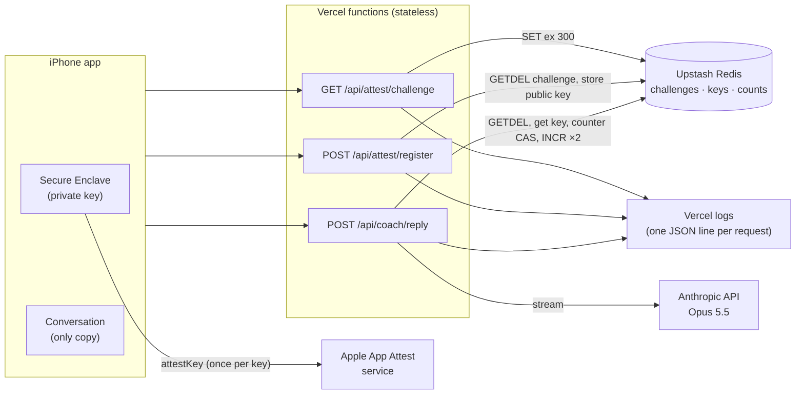
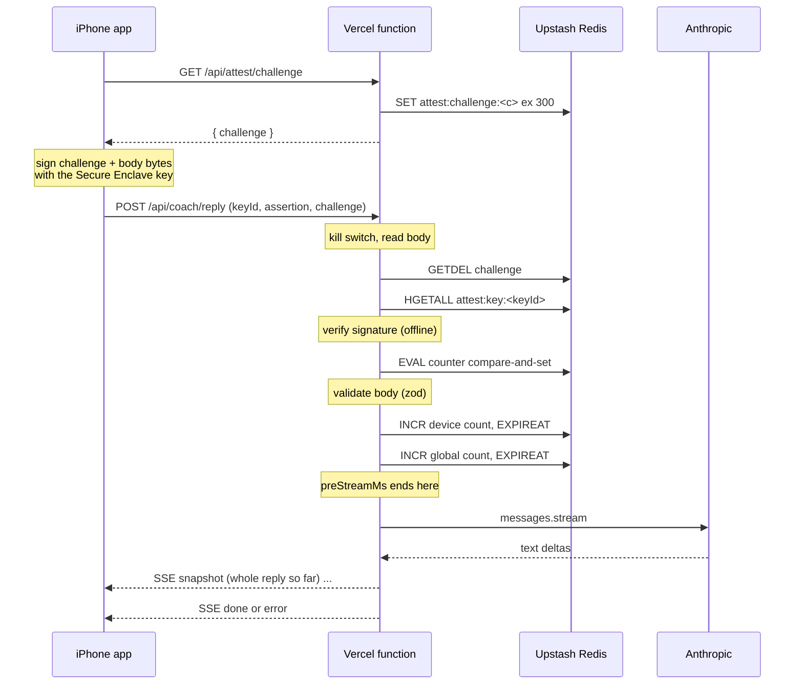

# DDIA learnings: steady-backend

Notes from working through *Designing Data-Intensive Applications* (1st ed.) against this
proxy. Each question was answered from intuition first, then checked against the code.
"My answer" is what I said before looking; "What the code says" is what settled it.

Code references are to `main` as of 2026-11-04 (after PR #1).

Status: Q1–Q2 done. Q3–Q21 open (listed at the end).

---

## System map

The backend talks to exactly two services: **Upstash Redis** and **Anthropic**. It never
calls Apple. Apple is involved in two places:

- **On the phone, once per key.** `attestKey` sends the new key to Apple, which returns an
  attestation: a certificate chain saying "this key is in a real device's Secure Enclave,
  running app `UXZV3C926U.com.jmagic.steady`".
- **On the server, offline.** Registration checks that chain against Apple's root
  certificate, pinned in `src/attest/apple-root.ts`, then stores the key's public key.
  Each reply's assertion is the phone's signature over `challenge + exact body bytes`
  (`replyClientData`), checked with that stored public key. Plain cryptography, no call to
  Apple.

### What Redis holds

No conversation text, ever. It's the backend's only memory; the functions are stateless.

| Key | Value | Lifetime | Responsible for |
| --- | --- | --- | --- |
| `attest:challenge:<challenge>` | `"1"` | 300 s, removed on first use (GETDEL) | Replay protection: each signed request is good once |
| `attest:key:<keyId>` | `{publicKey, counter}` | 180 days, renewed on use | Identity: which keys are genuine, last counter seen |
| `coach:count:device:<day>:<hash>` | integer | until next UTC midnight | Per-key daily limit (60) |
| `coach:count:global:<day>` | integer | until next UTC midnight | Global spend backstop (1,000) |

### Components



### One coach reply



---

## Ch 1: Reliability, scalability, maintainability

### Q1. Latency vs. time to first text: which is the user's experience?

**My answer.** Time to first text. The person is reading the words as they arrive, so
the wait before the first word is what feels slow. I assumed `firstTextMs` counts from
the moment the request reaches the function. For percentiles I'd watch p99, since
algorithms classes teach planning for the worst case.

**What the code says.**

- Time to first text is the right metric. On a successful reply `latencyMs` ends when the
  stream ends, so it mostly measures *how long the coach talked*, not slowness. On a
  cancelled reply it measures how long the person waited before giving up.
- **`firstTextMs` does not start when the request arrives.** `handleReply` and
  `streamReply` each declare their own `started` (`src/handlers/reply.ts`), and
  `firstTextMs` reads the inner one, set only when the upstream call begins. By then
  the request has already done five Upstash round trips (`takeChallenge`, `getKey`,
  `advanceCounter`, two `incrementDaily`) plus signature verification. So `firstTextMs`
  is **Anthropic's** time to first text, not the user's. The app's earlier
  `GET /api/attest/challenge` is a separate request on top of that.
- Only the phone can measure what the user actually waits (see Q20, end-to-end
  argument).

**Percentiles.** Big-O worst case is about input shape. DDIA's tail percentiles are about
people: p99 is what the unluckiest 1 in 100 real requests experienced. At this scale
(global cap 1,000/day) a day's p99 is the slowest ~10 requests, close to noise. Better:

- p50 and p95 of time to first text;
- read every slow outlier individually (one JSON log line per request), checking
  `fallback` and whether the key is new;
- never the mean: one 100 s timeout drags it away from anything a real person felt.

**Follow-up: one field to separate "Redis was slow" from "Anthropic was slow".**

A request writes one log line, so "add a log" means add a *field*, not print another
line. The timeline of one reply:

```text
request arrives                    Anthropic called       first word
     │                                    │                    │
     ├── read body                        │                    │
     ├── takeChallenge   (Redis)          │                    │
     ├── getKey          (Redis)          │                    │
     ├── verify signature (CPU)           │                    │
     ├── advanceCounter  (Redis)          │                    │
     ├── device count    (Redis)          │                    │
     ├── global count    (Redis)          │                    │
     │◄────────── not logged ────────────►│◄── firstTextMs ───►│
```

My first idea was a mark at signature verification. That misses `advanceCounter` and
both rate-limit counters, which come after it. The mark belongs right before the
upstream call: `preStreamMs`, request arrival → `streamReply`.

```ts
// src/handlers/reply.ts, just before streamReply (not implemented yet)
fields.preStreamMs = Date.now() - started;
```

| `preStreamMs` | `firstTextMs` | Diagnosis |
| --- | --- | --- |
| 1,800 | 900 | Redis or verification was slow |
| 150 | 6,000 | Anthropic was slow (check `fallback`) |

`preStreamMs + firstTextMs` is the server's best estimate of the user's wait.

**Follow-up: high `preStreamMs` only on the morning's first request?** My guess: the
server warming up (a cold start). Close, with one correction:

- A Vercel cold start (booting the instance, importing modules) happens *before the
  handler runs*, so it's before `started`. A clock started inside the handler can't see
  time that passed before the handler. Cold starts show up in Vercel's own metrics and on
  the phone, not in `preStreamMs`.
- What `preStreamMs` *does* catch on a fresh instance is cold **connections**:
  `productionDeps()` creates the Upstash client lazily, and the first REST call pays DNS
  and a TLS handshake that later calls on the same warm instance reuse. Same for the
  Anthropic client, whose first connection lands in `firstTextMs`.

**Takeaways.**

- Before trusting a metric, find where its clock starts.
- A timer inside a process can't measure what happened before the process got control.
- At low volume, read the slow requests one by one instead of trusting a high percentile.

**Possible change:** add `preStreamMs` to `LogEntry` and set it before `streamReply`.

### Q2. Load parameters: whose request fails when the global cap trips?

**My answer.** Whoever asks next. To get past the per-device 60, an abuser would use
multiple devices (not sure).

**What the code says.**

```ts
// src/rate-limit.ts
const device = await store.incrementDaily(`device:${day}:${subject}`, resetAt);
if (device > config.dailyLimit) return { ok: false, scope: "device", retryAfter };
const global = await store.incrementDaily(`global:${day}`, resetAt);
if (global > config.globalDailyLimit) return { ok: false, scope: "global", retryAfter };
```

- **Whoever asks next.** The global counter doesn't know who it's counting. Someone who
  already got 59 replies today is served; someone opening the coach for the first time
  at 23:00 UTC is refused. First come, first served. That's deliberate: the global cap
  protects the Anthropic bill (the comment above `checkDailyLimits`), not fairness.
  Naming which thing a limit defends is the point.
- **One phone is enough.** The "device" is the hash of an App Attest **key**, whatever
  `DCAppAttestService.generateKey` returned. Delete and reinstall the app → new key →
  fresh 60. About 1,000 / 60 ≈ 17 reinstalls on one phone uses up everyone's day.
- Nothing on the server limits `/api/attest/challenge` or `/api/attest/register`.
- App Attest stops scripted fake clients (requests must come from the genuine signed app
  on real Apple hardware). It doesn't stop a real person churning keys on a real phone.
  Apple's attestation **receipt** can be exchanged for a **risk metric** (roughly, how
  many keys this device made for the app in 30 days); the backend never reads it.

**Options, by effort.**

1. Accept it for the beta: the global cap already bounds spend.
2. Give young keys less: store the registration time; a key under a day old gets, say,
   10 replies instead of 60, so churning keys stops paying.
3. Use the receipt's risk metric at registration and refuse devices that churn keys.

**Takeaways.**

- A rate-limit key is only as good as the identity behind it. Here, identity = an app
  install, not a person or a phone.
- A global cap is a cost backstop with first-come-first-served semantics; say so instead
  of calling it fair.

**Decision (2026-11-04).** Option 1 while there are three users; move to option 2 at
about 7–10 users. I'm wary of option 3 because it means relying on Apple.

**Refinements.**

- Trigger on a signal you can see, not only a user count. Three users can make at most
  3 × 60 = 180 legitimate replies a day, so any day past that is abuse, a bug or key
  churn. Lower `COACH_GLOBAL_DAILY_LIMIT` (an environment variable, no deploy) to
  about 250, so the backstop tracks the real bill instead of ~16 heavy users. Move to
  option 2 when the logs show many `attest.register` 204s in a day.
- The Apple worry is a real distinction: **offline vs. online dependency.** Today
  attestation is verified offline against Apple's pinned root certificate
  (`src/attest/apple-root.ts`), with no call to Apple. The risk metric would add a
  network call to Apple on the registration path, coupling our availability to theirs.
  If adopted: fetch it in the background and treat "Apple didn't answer" as allow.

---

## Open questions

### Ch 1

- **Q3.** If Upstash is down, `/api/attest/challenge` returns 500 and the coach is fully
  unavailable. Is Redis a single point of failure? Should rate limiting fail open or
  closed when Redis is unreachable, and why?

### Ch 4: Encoding and evolution

- **Q4.** The app and server share hard limits (weekContext 1,200, person turn 1,000, 100
  turns). If I change a limit, which side ships first, and what happens to app builds
  already installed?
- **Q5.** The body schema allows "no other fields". How do I add a new field or a new `kind`
  without breaking old apps or an old server mid-deploy?
- **Q6.** Each SSE `snapshot` sends the whole reply so far, not a delta. What does that buy the
  client on a flaky connection, and what does it cost in bytes as the reply grows?
- **Q7.** The assertion's clientDataHash covers the exact body bytes. What breaks if any layer
  re-serializes the JSON?

### Ch 5: Replication

- **Q8.** Upstash may serve reads from replicas. Could a challenge that GETDEL already consumed
  still look unused on a lagging replica? What consistency does Upstash promise?

### Ch 7: Transactions and race conditions

- **Q9.** Advancing the App Attest counter is a Lua script. What exact race exists without it,
  and what does the book call it?
- **Q10.** Why GETDEL for challenges instead of GET then DEL? Two requests, same challenge,
  same instant.
- **Q11.** `checkDailyLimits` increments the device counter before the global check. If the
  global cap rejects, the device still lost one of its 60. Acceptable? A fix?
- **Q12.** Quota is spent before the upstream call. If Anthropic returns 529 or the app cancels,
  should a failed reply refund quota, and can it be done safely?
- **Q13.** Registering an existing key id replaces it and resets the counter to 0. Can anything
  replay an old attestation to roll a counter back? What stops it?

### Ch 8: Trouble with distributed systems

- **Q14.** Two concurrent requests can arrive out of order, and the older counter is rejected.
  Is that right, and what should the app do next?
- **Q15.** The daily reset computes EXPIREAT from the function's clock; Redis enforces it by its
  own. What if the clocks disagree near midnight?
- **Q16.** 110 s upstream deadline, 120 s function limit, 300 s challenge lifetime: why those
  numbers? What does the app see if the platform kills the function mid-stream?
- **Q17.** How is the App Attest counter like a fencing token, and how is it different?

### Ch 9: Consistency

- **Q18.** The global cap is correct because every instance increments one linearizable
  counter. What happens with multi-region Redis?

### Ch 11–12: Derived data, end-to-end, ethics

- **Q19.** The phone is the only source of truth for a conversation. Reinstall or new phone:
  deliberate privacy tradeoff or accident?
- **Q20.** The server can't dedupe a double-tapped Send, so two replies get charged. Per the
  end-to-end argument, where should duplicate suppression live?
- **Q21.** Logs carry a 12-hex hash of the key id. Could per-device cost be rebuilt from logs
  alone? Could someone link that hash back to a person?
